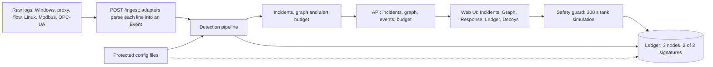
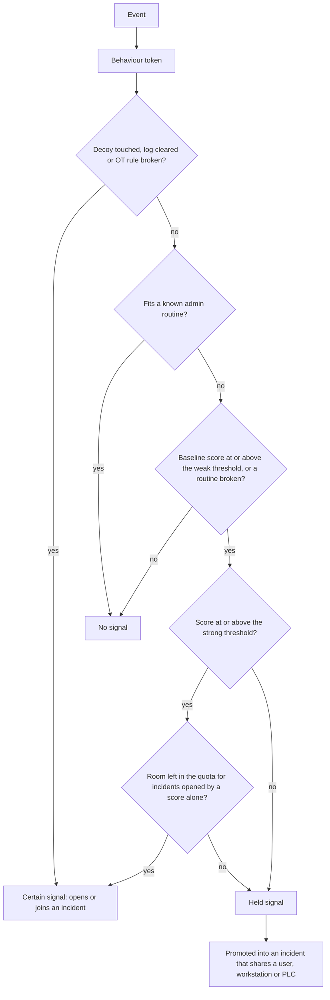
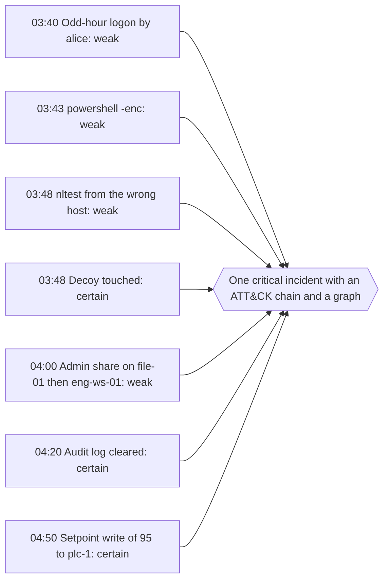
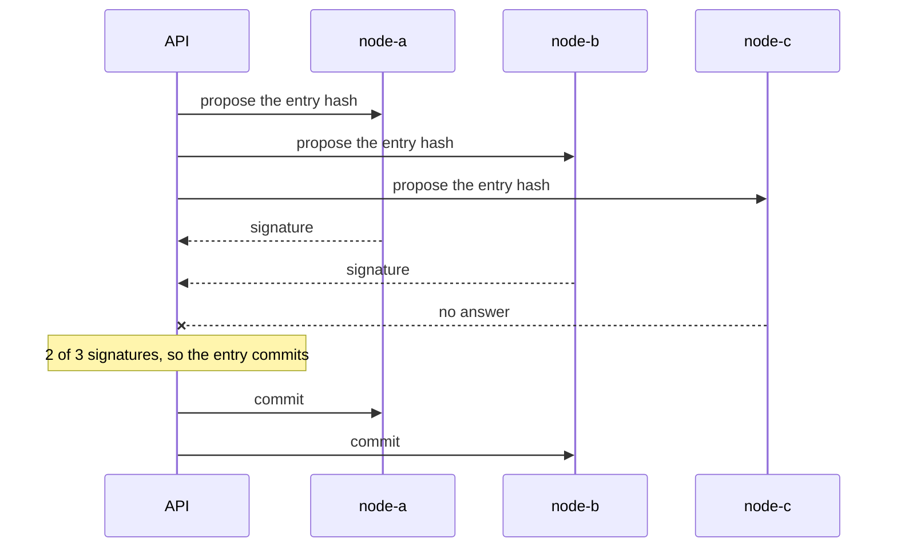
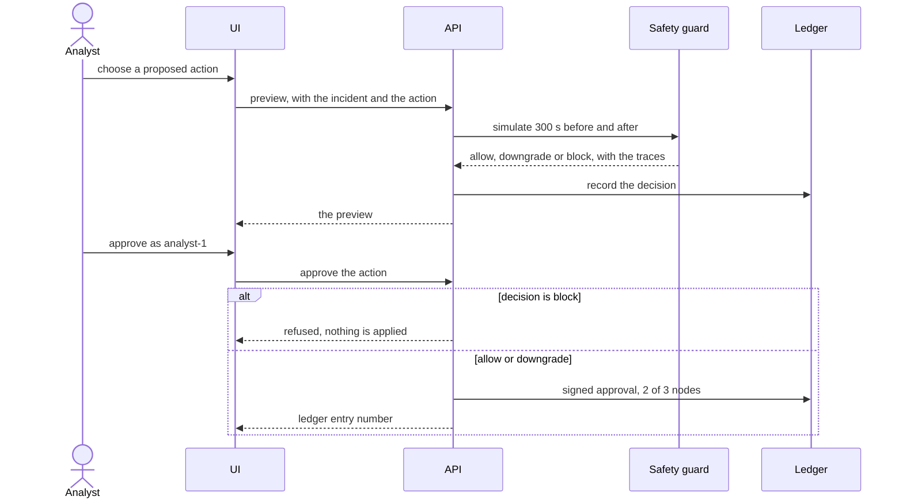

# Deconflicted

An offline IT/OT threat hunter. It finds attacks that use normal admin tools, joins weak signals into one incident mapped to MITRE ATT&CK, keeps false alarms within a budget, checks every automated response against process-safety rules, and records decisions in a hash-chained ledger across three nodes.

## What it does

## Overview



## How it works

1. Raw logs from six sources are parsed into one event type. The event id comes from the unchanged log line.
2. Each event becomes a behaviour token such as `proc:powershell_enc`.
3. A per-role statistical baseline scores how rare the behaviour is, by sequence and by hour of day. Rules add the certain signals.
4. The pipeline joins signals into incidents, applies the budget, and records each incident in the ledger.
5. The analyst previews a response, approves it, and the decision is signed into the ledger.

### What happens to one event



### How signals become one incident

The demo attack as the system sees it. Weak signals are held until a certain signal opens the incident, then they are pulled in.



### How the ledger signs an entry

Each node signs the entry hash when it is proposed. The entry commits once two of the three have signed. One node can be down.



### How a response is approved



- **Finds attacks that look normal.** It learns what each role does on a normal day (admin, helpdesk, engineer, operator, service account) and flags behaviour that does not fit. A known admin routine is left alone.
- **Certain signals.** Touching a decoy, clearing an audit log and writing an out-of-range value to the PLC are always flagged, whatever the score.
- **One incident, not a pile of alerts.** Weak signals are held and joined into one incident when they share a user, a workstation or a PLC. The incident has an ATT&CK timeline, the point where the activity stops matching a routine, and a graph.
- **A false-alarm budget.** At most 5 incidents per day, and at most 3 of them opened by a score alone.
- **Safe response.** Every proposed action is simulated against a water-tank model for 300 seconds. The guard allows it, downgrades it to a safer option or blocks it. It fails closed on any error.
- **A record nobody can quietly change.** Detections, guard decisions and approvals go into a hash-chained ledger on three nodes. Each entry needs 2 of 3 signatures. A changed entry, or a changed safety config file, is detected.

## Run it

You need Python 3.11 and Node 22. The repository already holds the demo data, the trained baseline and the calibrated threshold.

Set up once (Windows PowerShell):

```
py -3.11 -m venv .venv
.venv\Scripts\python -m pip install -r requirements.txt
cd web
npm ci
cd ..
```

Then use three terminals in the project folder. In the first, start the API with an in-process ledger:

```
.venv\Scripts\Activate.ps1
$env:DECONFLICTED_LEDGER_EMBEDDED = "1"
python -m uvicorn deconflicted.api.main:app --port 8000
```

In the second, start the UI against it:

```
cd web
$env:VITE_API = "live"
npm run dev
```

In the third, replay the attack. At 60 times speed it takes about 90 seconds:

```
.venv\Scripts\Activate.ps1
python -m deconflicted.sim.replay --file data\demo\scenario.jsonl --speed 60 --url http://localhost:8000
```

Open http://localhost:5173 and watch the incident build. Without `VITE_API=live` the UI shows the mock data in `web/mock/`.

### Docker

```
make demo
docker compose --profile demo run --rm replay
```

The UI is at http://localhost:8080. The stack was built and tested in pieces. It has not been run end to end on the final code, so run it once before relying on it.

## Results

All numbers come from `data/eval/report.json`, written by `make calibrate`. The data is simulated: a scripted attack and its 10 variants, mixed into simulated normal days. They show that the engine works as designed. They are not a measure of how it would do against a real attacker.

| Measure | Result |
|---|---|
| False incidents on a held-out normal day (budget 5) | 3 |
| Attack scenarios with exactly one incident | 11 of 11 |
| Attack scenarios missed | 0 |
| Chain recall (labeled steps found) | 1.0, mean and worst |
| Zero-disruption violations in 300 random safety cases | 0 |
| Ledger tampers found at the right entry | 5 of 5 |

The optional PyTorch scorer was not evaluated (PyTorch was not installed for the run), so it stays off. To change the thresholds, edit `config/detection.yaml`, or run `make calibrate` again.

## How it works

1. Raw logs from six sources are parsed into one event type. The event id comes from the unchanged log line.
2. Each event becomes a behaviour token such as `proc:powershell_enc`.
3. A per-role statistical baseline scores how rare the behaviour is, by sequence and by hour of day. Rules add the certain signals.
4. The pipeline joins signals into incidents, applies the budget, and records each incident in the ledger.
5. The analyst previews a response, approves it, and the decision is signed into the ledger.

## Layout

- `deconflicted/` holds all Python: `adapters/`, `ingest/`, `core/` (detection), `eval/`, `sim/`, `deception/`, `response/`, `ledger/`, `ml/` and `api/`.
- `config/` holds the YAML settings. `data/` holds the demo data and the evaluation report.
- `web/` is the UI. `docs/` is documentation. `tests/` holds the Python tests.

## Limits

- It is a prototype for an isolated network. There is no login: the analyst name is a label checked against a list.
- It has only been run on simulated data in the spec's sample log formats. New formats need a mapping file (`docs/ingest.md`).
- The safety guard simulates one water tank.

## More

- `AGENTS.md`: setup, folder ownership and the rules for every change.
- `docs/scenario.md`: the attack story the tests and the demo follow.
- `docs/conventions.md`: ids, tokens and the ledger hash recipes.
- `docs/metrics.md`: how each number is measured.
- `docs/ingest.md`: how logs are read and how to add a format.

## Credits

The web UI is adapted from NeuralShield (https://github.com/atif09/sh).